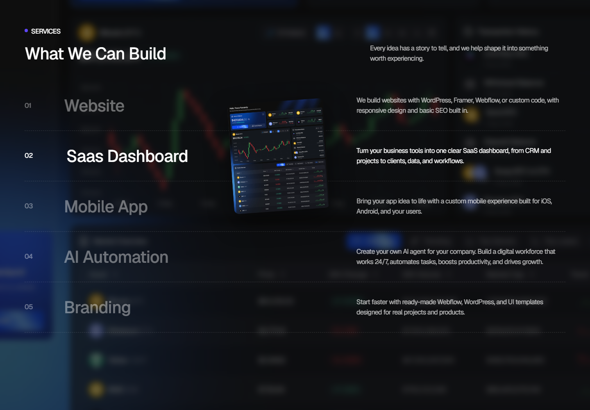
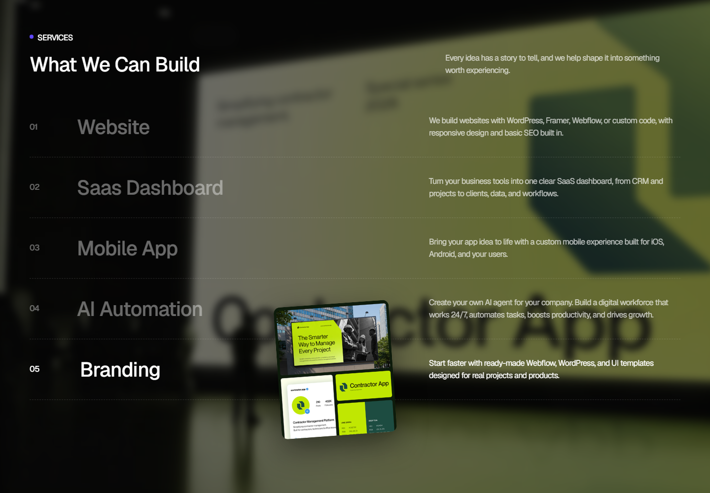
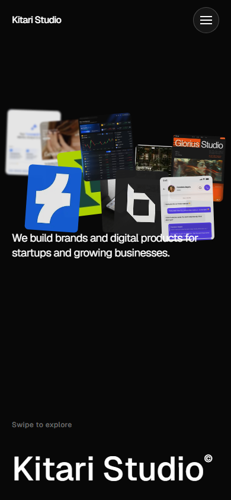
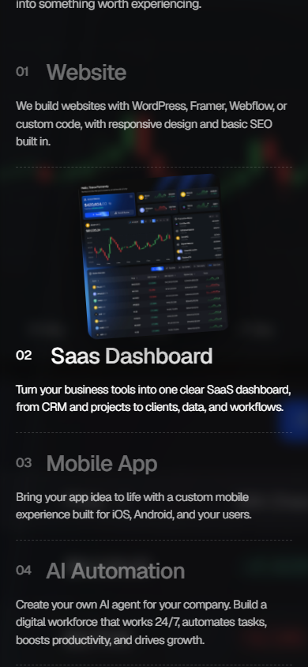

# Kitari Studio

**Live website / interactive prototype:** [kitaristudios.web.app](https://kitaristudios.web.app/)

**Source repository:** [github.com/RanggaNf/kitari-studio](https://github.com/RanggaNf/kitari-studio)

Kitari Studio is a responsive studio website and portfolio with scroll-led
motion, service previews, project stories, and Firebase-backed content and
admin tools. The live link is the interactive prototype; the separate HTML
reference prototypes and unrelated root assets are intentionally not part of
this website repository.

## Screenshots

Screenshots below show representative interactive states. Visit the live
website to experience the complete pointer, touch, hover, click, and scroll
animations.

### Desktop


| Services — SaaS Dashboard selected                                                                      | Services — Branding selected                                                                          |
| ------------------------------------------------------------------------------------------------------- | ----------------------------------------------------------------------------------------------------- |
|  |  |

### Mobile

| Touch-activated homepage cards                                                        | Services — SaaS Dashboard selected                                                              |
| ------------------------------------------------------------------------------------- | ----------------------------------------------------------------------------------------------- |
|  |  |

## Features

- Responsive homepage, navigation, catalogue, About, Services, work, testimonials,
  FAQs, contact, and footer.
- Interactive hero card composition with pointer trails on desktop and
  touch-activated card reveals on mobile.
- Scroll-driven About image expansion and statistics, animated section reveals,
  smooth scrolling, and layered project cards.
- Services card and background selection by scroll, hover, click, and keyboard
  focus. The first display-order service stays transparent; other services can
  use their preview image or an optional 16:9 background image.
- Admin content tools for services, projects, catalogue, testimonials, FAQs,
  site settings, leads, and newsletter subscribers.
- Cloudinary image upload and cropping in the admin interface.
- Firebase Authentication and Firestore-backed published content, with local
  fallback content when public content cannot be loaded.
- SEO metadata, sitemap, robots rules, and structured data.
- Reduced-motion support and mobile-specific layouts/interactions.

## Technology

| Area                       | Tools                                                     |
| -------------------------- | --------------------------------------------------------- |
| Web application            | Next.js App Router, React, TypeScript                     |
| Styling                    | CSS, Tailwind CSS tooling                                 |
| Motion and scrolling       | GSAP, ScrollTrigger, Lenis                                |
| Content and authentication | Firebase Web SDK, Firestore, Firebase Authentication      |
| Admin image workflow       | Cloudinary unsigned image uploads and client-side crop UI |
| Validation                 | Zod                                                       |
| Quality                    | ESLint, Prettier, TypeScript, Playwright, Vitest          |
| Hosting                    | Firebase Hosting with a Next.js static export             |

## Project structure

```text
.
├── .github/workflows/       # GitHub Actions checks
├── docs/screenshots/        # Public UI screenshots used in this README
├── firebase.json            # Hosting, emulator, Firestore configuration
├── firestore.indexes.json   # Firestore indexes
├── firestore.rules          # Firestore access rules
└── website/
    ├── e2e/                 # Playwright browser tests
    ├── public/              # Website images and static assets
    ├── scripts/             # Local seed and admin utilities
    └── src/
        ├── app/             # Routes, layouts, and global styles
        ├── components/      # UI, forms, motion, and page components
        ├── data/            # Local fallback content
        ├── hooks/           # Shared React hooks
        └── lib/             # Firebase, Cloudinary, schemas, and data access
```

## Run locally

### Requirements

- Node.js 20.9 or newer
- npm
- Firebase CLI (for emulators and Hosting deployment)

### Install and configure

```powershell
Set-Location .\website
npm ci
Copy-Item .env.example .env.local
```

Fill in the Firebase Web App values in `website/.env.local`. The example file
contains placeholders for Firebase API/app identifiers and the public
Cloudinary upload configuration. These browser-side values are not Firebase
Admin credentials. Never put a service-account key in the website or commit it.

Start the site:

```powershell
npm run dev
```

Open [http://localhost:3000](http://localhost:3000). For Firebase-backed
content, use a Firebase project with the required collections and rules. To
work locally against emulators, set `NEXT_PUBLIC_FIREBASE_USE_EMULATORS=true`
in `.env.local` and start the emulators from the repository root:

```powershell
firebase emulators:start --project kitaristudios --only auth,firestore
```

## Validation

Run these from `website/`:

```powershell
npm run format:check
npm run lint
npm run typecheck
npm run build
```

Browser tests and Firestore rules tests use the local Firebase emulators:

```powershell
npm run test:e2e:emulator
npm run test:rules:emulator
```

The E2E setup creates test-only accounts and records in the emulator; it does
not target production.

## Deploy

The Next.js production build exports static files to `website/out`. Firebase
Hosting is configured to publish only that directory. From the repository
root:

```powershell
Set-Location .\website
npm run build
Set-Location ..
firebase deploy --only hosting --project kitaristudios
```

This command deploys Hosting only; it does not deploy Firestore rules or
indexes. Review and test backend changes separately before deploying them.

## Security and configuration

- Root and website `.gitignore` rules exclude environment files, private
  Firebase service-account keys, dependencies, build output, caches, logs, and
  test artifacts. `website/.env.example` is a safe placeholder template and is
  intentionally allowed in Git.
- Never commit GitHub tokens, Firebase Admin credentials, user data, or
  production environment files. Rotate any credential that is accidentally
  shared.
- Cloudinary upload preset settings must enforce suitable file type, size, and
  folder restrictions; client-side checks alone are not a security boundary.
- Firestore rules limit public reads to published content and restrict admin
  operations to verified accounts with the appropriate custom claim.

## CI

GitHub Actions runs dependency installation, formatting checks, lint, type
checking, and a production build for website changes and pull requests.
